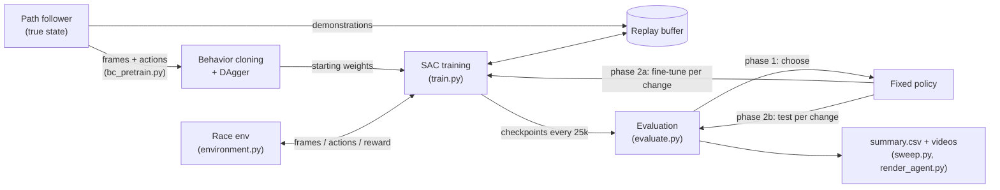

# Training Methods

We train a SuperTuxKart driving policy that sees only camera frames. The policy is a recurrent soft actor-critic (SAC) agent: a CNN encodes each frame, a GRU keeps a belief over time, and an actor chooses the controls. Training starts from a behavior-cloned copy of a scripted driver that uses the game's true state, then SAC improves on it with a reward computed from that true state. Once one setup is tuned, we change the reward and the world to see how the agent's driving changes. `TRAINING_PLAN.md` has the commands; this page explains the methods.

## How everything fits together

## The problem: a POMDP

| Part | In our setup |
| --- | --- |
| Hidden state | The game's internal state: kart positions and velocities, the track, the opponent, items |
| Observation | One 128×96 RGB camera frame per step (0.1 s of game time) |
| Belief | The GRU's hidden state, a learned summary of recent frames and actions |
| Action | 5 numbers: acceleration (0–1), steer (−1–1), and brake, drift, nitro (on/off, pressed above 0.5) |
| Reward | Computed from the hidden state (below); the policy never sees that state |
| Episode end | Finishing the lap or getting stuck ends the episode (`terminated`); 1500 steps cuts it off (`truncated`) |

The true state is used only during training: for the reward, for the scripted teacher, and for logging. A trained policy drives from frames alone.

## The environment (`environment.py`)

One-lap races on `lighthouse` against one AI opponent (novice by default) through pystk2. Each `reset()` starts a seeded race and skips the countdown; each `step()` applies the action for 0.1 s and returns the next frame.

| Reward term | Value | Purpose |
| --- | --- | --- |
| Progress | +0.1 per meter; off-road meters count half | Drive forward; prefer the road |
| Time | −0.03 per step | Finish sooner |
| Leading | +0.02 per step in 1st | Race the opponent |
| Finish / win | +5 / +15 more if 1st | Complete the lap, and win it |
| Stuck | −10 and the episode ends | Never let parking look better than trying |

Off-road is a factor on progress rather than a flat penalty, and getting stuck is a failure, because otherwise standing still scored better than an untrained agent's driving and the agent learned to park. Every setting (track, kart, number of karts, each reward weight, action noise, action delay, no brakes) is a named option, which is how experiments change the world without code changes.

## The agent (`SAC_CNN_Pixels.py`)

- **Encoder:** a CNN turns each frame into 128 numbers.
- **Belief:** a GRU combines those over time; its output stands in for the hidden state.
- **Actor:** outputs a mean and spread for each of the 5 actions; a sample goes through tanh to stay in range. Evaluation uses the mean action.
- **Twin critics:** two networks estimate Q(belief, action); the smaller estimate is used, to avoid over-optimism.
- **Target critics:** slow copies of the critics (updated by 0.5% per step, τ = 0.005) compute the training targets, so the targets don't shift with every update. Without them, training rose and then collapsed.
- **Automatic α:** the entropy weight is learned to keep the policy's randomness near a target (−5, one per action), instead of being a fixed hyperparameter.
- **Image augmentation:** during updates, each training sequence is shifted by the same random amount (up to 4 pixels), which makes the encoder robust to small changes in the view and improves sample efficiency. It costs no measurable time.
- **What trains what:** the critic loss trains the encoder and GRU along with the critics; the actor learns on top of a detached belief.

**Replay** (`replay_buffer.py`) stores up to 30,000 transitions in the experiments and samples 8-step sequences that stay inside one episode. Each sequence carries 9 frames, so the GRU can produce the belief before and after every action.

**One training step:** the agent picks an action from the current frame (carrying the GRU state forward), the environment returns the reward and next frame, the transition goes into replay, and one gradient update runs on a batch of 32 sequences: augment, encode, update the critics and their targets, update the actor, update α.

## Warm start: behavior cloning (`bc_pretrain.py`)

- **Teacher:** the path follower, which drives at full throttle and steers toward the second upcoming centerline point using the true state. Against the novice opponent it finishes and wins every lap.
- **Recording:** it drives about 20 races. Random steering noise is added to the action it executes but not to the recorded label, so the recordings also show how it recovers from being off the line.
- **Student:** the pixel policy (encoder + GRU + actor) learns to output the teacher's action from frames alone (mean squared error on the mean action).
- **DAgger:** plain cloning breaks down once the student drifts somewhere the teacher's recordings never went. So for 3 rounds the student drives, the teacher labels every frame the student actually reaches (it can read the true state anywhere), and the student retrains on all the data. In testing, a student cloned from 10 races alone got stuck after 313–405 m of the 881 m lap; after DAgger it finished every test race at the teacher's pace (about 60 s against novices).
- **Hand-off to SAC:** SAC starts from the student's weights, with all recordings (about 15,000 transitions) preloaded into replay. For the first 2,000 updates only the critics train (a critic warm-up), so the untrained critics can't pull the cloned actor off course before they've learned anything.

This is "learning by cheating": a teacher with privileged information trains a student that has only the camera.

## Evaluation (`evaluate.py`)

Each checkpoint races 20 fixed seeds with its mean action. Every race records finished, won, stuck, finish time, distance, mean speed, off-road fraction, steering jerk, yaw rate, crashes, and how often the policy pressed brake, drift and nitro. Races don't repeat exactly, even on the same seed, so 20 races average out race-to-race variation; differences between training seeds are the bigger source of luck. `sweep.py summary` averages each CSV into one row per policy, then averages each setting over its training seeds (mean ± standard deviation).

## Experiments (`sweep.py`)

| Phase | What happens | Why |
| --- | --- | --- |
| Sanity | Score stand still, reverse, random and the path follower under the reward | Make sure quitting never beats driving |
| Warm start | Record the teacher, clone it, refine with DAgger, evaluate the clone | Starting point for every SAC run, and a reference row |
| Phase 1 | γ ∈ {0.98, 0.99, 0.995} × 2 seeds, 150k steps each, checkpoints evaluated at 50k/100k/150k | Choose γ and training length; seeds show what's luck |
| Phase 2a | Fine-tune the chosen checkpoint for 50k steps under each of 8 reward or physics changes, plus an unchanged control, each with 3 seeds | How the agent's decisions adapt (speed vs. recklessness) |
| Phase 2b | Evaluate the chosen checkpoint, unchanged, under world changes, several at more than one strength | Robustness: harder opponents, more karts, noise, delay, another kart, an unseen track |

Phase 2 fine-tunes from one policy rather than retraining each change from scratch: it halves the cost and starts every change from the same driver. The unchanged control gets the same extra training, so every comparison is fair, and its 3 seeds show how far fine-tuning luck alone moves the results: a change only counts if it moves them further than that.

## Key choices and why

- **Pixels for the policy, true state for training.** The research question is driving from vision; the reward and the teacher need the true state, and they only exist during training.
- **Novice opponent.** It's the only level where winning is possible for a decent driver, so the win bonus can teach something. Difficulty also changes our own kart's speed, so lap times are only compared within one difficulty.
- **Stability before tuning.** Target critics and automatic α come first; otherwise a sweep mostly measures which run happened not to collapse.
- **Reward weights are perturbations, not tuned hyperparameters.** They define what good driving is, so changing them is the experiment, not the setup.

## References

- Haarnoja et al., "Soft Actor-Critic" (2018) and "Soft Actor-Critic Algorithms and Applications" (2018): SAC and automatic α.
- Fujimoto et al., "Addressing Function Approximation Error in Actor-Critic Methods" (2018): twin critics and target networks.
- Kostrikov, Yarats and Fergus, "Image Augmentation Is All You Need" (DrQ, 2020): random-shift augmentation.
- Laskey et al., "DART: Noise Injection for Robust Imitation Learning" (2017): noisy demonstrations.
- Ross, Gordon and Bagnell, "A Reduction of Imitation Learning and Structured Prediction to No-Regret Online Learning" (DAgger, 2011).
- Chen et al., "Learning by Cheating" (2019): a privileged teacher for a vision-only student.
- Kochenderfer, Wheeler and Wray, *Algorithms for Decision Making*: actor-critic (ch. 13), model-free methods and experience replay (ch. 17), imitation learning (ch. 18), beliefs (ch. 19).
